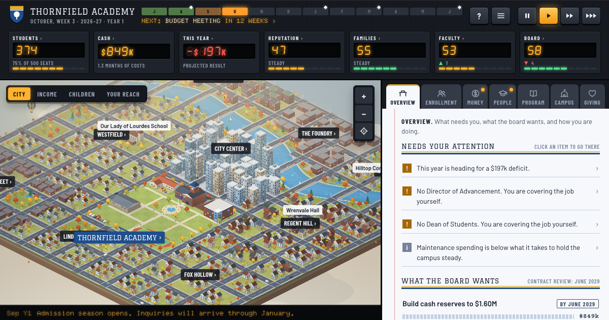

# Head of School

A management sim about running an independent K–12 day school. Fill the seats, keep the faculty, balance the books, answer to a board, and try to leave the place better than you found it.

**Play it in your browser: https://michaellomuscio.github.io/head-of-school/**

No install, no account, nothing to download. It works on a laptop or a phone.



## Contents

- [What the game is](#what-the-game-is)
- [Your first ten minutes](#your-first-ten-minutes)
- [The school year](#the-school-year)
- [How a school works](#how-a-school-works)
- [What you control](#what-you-control)
- [Your time](#your-time)
- [The strategic plan](#the-strategic-plan)
- [Dilemmas](#dilemmas)
- [The board, your contract and how it ends](#the-board-your-contract-and-how-it-ends)
- [Legacy and banners](#legacy-and-banners)
- [Missions and starting points](#missions-and-starting-points)
- [The city and its names](#the-city-and-its-names)
- [Controls](#controls)
- [Saving and privacy](#saving-and-privacy)
- [How it is built](#how-it-is-built)
- [Build and run locally](#build-and-run-locally)
- [Tests](#tests)
- [Local preview hooks](#local-preview-hooks)
- [Adding to the game](#adding-to-the-game)
- [Credits](#credits)

## What the game is

You have just been hired as head of an independent school in a city that is generated fresh for every game. The school has thirteen grades, three divisions, a faculty, a campus, an endowment, some debt and a board of trustees with opinions.

Time runs week by week through the school year. Most of what you control can change at any moment: how many teachers each division has, how deep each program runs, what you spend on marketing and upkeep, what you build. Three decisions happen once a year and the game stops for each: the budget, admission decisions, and your review by the board.

Nothing in the game is scripted to go well or badly. Enrollment comes from families in nine neighborhoods weighing your reputation, your price and the drive against three competitors and their public schools. Money comes from tuition after aid, giving, the endowment and summer programs. People respond to how they are paid and treated. The numbers on screen are the model's own, and every one of them can be opened to see what is pushing it.

A full tenure is ten years or more. Each ends with a legacy score out of 1,000 and a title for what you will be remembered for.

## Your first ten minutes

1. **Name the school.** A name is generated for you; press Shuffle for another or type your own. Pick colors, an emblem, a mission and a starting point. *New city* draws a different map and different competitors.
2. **Read the letter from the board chair.** It tells you where the school stands and the three goals of your first contract.
3. **Look around while the clock is paused.** The Overview tab lists what needs attention and has a short list of first steps. Click a neighborhood on the map. Click any number in the top row to see what drives it.
4. **Press play.** The game pauses itself whenever a decision needs you.
5. **Watch Opening Day in August.** The enrollment you open with is the revenue you live on until June.

A sound first year: staff each division near nine students per teacher, fill the empty senior-team seats you can afford, keep marketing on through admission season, and do not cut maintenance to make the budget work. The bill for that arrives in January, when the boiler does.

## The school year

A year is 48 weeks, July through June.

| When | What happens |
| --- | --- |
| July | The new year begins. Tuition, salaries and the incoming class take effect. A quiet month to hire and build. |
| August | **Opening Day.** A few families change plans over the summer and a few enroll late. This number is your budget for the year. |
| September to January | **Admission season.** Applications arrive from each neighborhood according to reputation, price, awareness and distance. The annual fund drive begins. |
| January | **Budget meeting** (the game pauses). You set next year's tuition increase and salary pool. |
| February | The application deadline passes, then **re-enrollment**: current families decide whether to return. |
| March | **Admission decisions** (the game pauses). You choose how deep to admit in each division and how much financial aid to offer. |
| April | Deposits arrive. Teachers announce who is leaving. |
| June | Commencement, then the **board review** (the game pauses): six grades and, every third year, a vote on your contract. |

## How a school works

Four things drive nearly everything else.

**Teaching quality** is the product. It is built from faculty quality, class size, program depth and facilities. Families feel it within months.

**Family satisfaction** follows teaching quality, student life, the state of the campus and value for the price. It decides who re-enrolls and who gives.

**Reputation** moves slowly. It is built from teaching quality, college results, what current families say and the academic profile of the students you admit. It decides how many families apply.

**Faculty morale** follows pay against the market, workload, professional growth and whether last year's raise beat inflation. Low morale costs you your best teachers first, and their replacements are only as good as your pay and reputation can attract.

Around those:

- **Money.** Tuition less financial aid is most of your revenue. People are most of your cost. An empty seat costs almost nothing to fill, so enrollment is the strongest financial lever you have, and the slowest.
- **Classes roll forward.** A small Kindergarten is a small fifth grade five years later. Grades 5 and 8 are where families most often leave.
- **Aid follows the student.** A scholarship offered in March is a cost every year until that student graduates.
- **The campus wears out.** Spend 1.5% of building value on maintenance and it holds steady. Spend less and it decays, and worn buildings fail at inconvenient moments.
- **The economy moves.** Inflation, market returns and, sooner or later, a recession.

## What you control

Seven tabs hold every setting.

| Tab | What is there |
| --- | --- |
| **Overview** | What needs attention, the board's goals, your time, the strategic plan, banners, legacy, trends and the bulletin. |
| **Enrollment** | The admission funnel, students by grade, the marketing budget, focus neighborhoods, bus routes and your competitors. |
| **Money** | The annual budget line by line, tuition, the balance sheet, borrowing and repayment, and year-by-year history. |
| **People** | Faculty morale, quality and pay; teachers per division; professional growth; and your five-person senior team. |
| **Program** | Seven programs at levels 0 to 5: Core Academics, STEM, Arts, Athletics, Wellness and Learning Support, College Counseling, and Summer and Auxiliary (the one that earns money). |
| **Campus** | Condition and maintenance, seats per division, renovation and twelve things to build. |
| **Giving** | The annual fund, the endowment and its draw rate, capital campaigns and the building fund. |

**The senior team.** Director of Admission, Chief Financial Officer, Director of Advancement, Dean of Faculty and Dean of Students. Each is rated one to five stars and changes how well their part of the school runs. A vacant seat means you are covering the job yourself, badly. Stronger candidates apply to schools with stronger reputations.

**Buildings.**

| Building | Cost | Time | What it does |
| --- | --- | --- | --- |
| Lower, Middle and Upper School Wings | $3.2M to $4.2M | 9 to 10 months | 45 to 60 more seats in that division. Can be built more than once. |
| Library and Learning Commons | $4.5M | 11 months | Unlocks Core Academics levels 4 and 5. Signature building. |
| Science and Innovation Center | $9.5M | 15 months | Unlocks STEM levels 4 and 5. Signature building. |
| Performing Arts Center | $8.0M | 14 months | Unlocks Arts levels 4 and 5; rental income. Signature building. |
| Field House | $8.5M | 14 months | Replaces the Old Gym. Unlocks Athletics levels 4 and 5; rental income. Signature building. |
| Dining Commons | $3.6M | 10 months | Lifts satisfaction; small rental income. |
| Early Learning Center | $2.8M | 8 months | A Pre-K that feeds Kindergarten and earns tuition of its own. |
| Stadium and Turf Field | $2.2M | 5 months | Spirit, satisfaction and rental income. |
| Solar and Geothermal | $1.4M | 4 months | Cuts building operating costs by 12% for good. |
| Faculty Housing | $2.6M | 6 months | Morale, stronger hires and fewer departures. |

Prices rise with inflation. Campaign gifts are spent first; the rest is paid in cash or with a bond. The campus has seven building sites.

**Capital campaigns** come in three sizes: Modest, Ambitious and Stretch. A campaign runs two or three years, lightens the annual fund while donors are being asked twice, and costs you with the board if you miss a public goal.

## Your time

Your own calendar is a budget. You have ten days a month to spend in five places:

| Where | What it does |
| --- | --- |
| In classrooms | Faculty morale, and teachers grow faster. |
| With families | Family satisfaction. |
| With donors | The annual fund and campaigns. |
| At admission events | More applications and better yield. |
| With trustees | Board confidence, slowly. |

Two days in each is what people expect and has no effect either way. More helps, a little less with each added day. Fewer is noticed, and none at all is noticed a great deal. A change takes a few months to be felt, so the calendar rewards a plan more than a reaction.

## The strategic plan

After your first year, and again each time your contract is renewed, the board adopts one pillar of a strategic plan. You are offered three, drawn from thirteen. A pillar is permanent, and each one costs something.

| Pillar | What it does |
| --- | --- |
| Faculty First | Stronger hires and faster teacher growth; faculty morale +4; costs about $1,800 per teacher a year. |
| The Open Door | 35% more aid applicants, and more of them say yes; more families give; reputation +1.5; full-pay families grow more price sensitive. |
| Selective by Design | Stronger applicants; reputation +2; parents react half again as hard to college results. |
| City as Classroom | 20% more applicants from downtown, university and arts neighborhoods; teaching quality +1.5; costs $110k a year. |
| Global Campus | About 8 more full-pay Upper School applicants a year; families −2.5 unless Wellness is Strong; costs $90k a year. |
| Year-Round Campus | Auxiliary income +40%; buildings wear faster; faculty morale −1.5. |
| Green Campus | Building operating costs −10%; reputation +1 and 4% more applicants; costs $350k up front. |
| Culture of Giving | Annual fund and campaigns +14%; families −1, because the asking never stops. |
| The Tuition Promise | Retention +1.5% and 6% more applicants; tuition can rise no more than 1.5 points above inflation. |
| One School, K–12 | Far fewer families leave after grades 5 and 8; families +1; costs $70k a year. |
| Lean Operations | Administrative and operating costs −6%; faculty morale −2 and families −1. |
| Known and Cared For | Families +2.5 and retention +0.8%; costs $130k a year. |
| Every Neighborhood | Bus routes cost half; more families in every neighborhood know you; costs $80k a year. |

Dollar costs are at year-one prices and rise with inflation.

## Dilemmas

Every couple of months something lands on your desk. There are 54 of them. A donor would like his daughter's B+ to be an A−. The boiler dies in January. Forty teachers petition to ban phones. The seniors release three goats numbered 1, 2 and 4. A search firm calls about another job. A gift arrives with a name attached that you would rather not put on a building.

Each choice shows which way it pushes families, faculty, reputation, giving, the board or the bank account. Some carry a risk that is flagged but not quantified. Some depend on the school you have built: a restorative process works if you have real counselors, and a reporter's feature reflects your actual teaching quality. A few have consequences that arrive a year later, and one lets you choose your next board chair, which changes the rules for the rest of the game.

Many only come up in the right circumstances: in winter, during a campaign, when pay has fallen behind, when morale is low enough that union cards are being signed.

## The board, your contract and how it ends

The trustees hired you and can replace you. Each June they grade six areas: Enrollment, Finances, Program, Faculty, Families and Advancement. They grade against where the school stood when you arrived, and they expect more every year.

They also set three goals at a time, such as enrolling a number of students, finishing years in the black, reaching a reputation or opening a signature building. Meeting a goal adds to their confidence; missing one costs it.

Every third June they vote on your contract. A tenure ends one of five ways:

| Ending | How |
| --- | --- |
| **Retirement** | From your tenth year on, you may step down on your own terms. |
| **Contract not renewed** | Board confidence is below 35 at a contract vote. |
| **Dismissed** | Board confidence falls to 10 at any time. |
| **Insolvent** | Cash runs past the credit line a second time. The trustees cover it once. |
| **Closed** | Enrollment falls below 110 students. |

## Legacy and banners

**Legacy** is scored out of 1,000 across seven areas.

| Area | Points | What counts |
| --- | --- | --- |
| Enrollment | 150 | Growth from where you started. |
| Financial strength | 200 | Cash, endowment and building fund, less debt, after inflation. |
| Reputation | 200 | Where it stands at the end. |
| Teaching | 150 | Teaching quality across the divisions. |
| Faculty | 100 | Morale and quality together. |
| Access | 100 | The share of students on aid, and how many neighborhoods you draw from. |
| Campus | 100 | Condition, and signature buildings opened. |

Your title comes from the area you improved most: The Grower, The Steward, The Standard-Bearer, The Teacher's Head, The Faculty's Champion, The Door-Opener or The Builder.

**Banners** hang in the gym. There are sixteen.

| Banner | How it is earned |
| --- | --- |
| Full House | Open the year with 95% of seats filled. |
| In the Black | Finish three straight years with a surplus. |
| Market Pay | Bring faculty pay to 100% of market. |
| Talk of the Town | Reach a reputation of 70. |
| First Choice | Hold a higher reputation than every competitor. |
| Master Teachers | Reach a teaching quality of 80. |
| Hard to Get Into | Admit fewer than half of your applicants with 90% of seats filled. |
| They Stay | See 94% of families re-enroll. |
| Open Doors | Have 30% of students on financial aid. |
| The Whole City | Enroll at least 15 students from every neighborhood. |
| Signature Campus | Open all four signature buildings. |
| Twice the Endowment | Double the endowment you inherited, after inflation. |
| Mortgage Burned | Pay off every dollar of debt. |
| Over the Top | Close a capital campaign above its goal. |
| Weathered the Storm | Finish a recession year with a surplus. |
| Honor Roll | Earn a report card with nothing below an A−. |

Finished tenures are kept in the **Hall of Heads** on the start screen, best legacy first. The end screen has a year-by-year table and a short text record you can copy and share.

## Missions and starting points

**Missions** shape who applies and what families care about.

| Mission | In play |
| --- | --- |
| College Preparatory | College counseling works 30% harder; families pay a premium more willingly; parents react twice as hard to college results. |
| Progressive | +1.5% retention; Arts and Wellness cost 25% less; college results count for less either way. |
| STEM and Innovation | STEM costs 25% less and counts double; extra pull in tech-heavy neighborhoods; enrollment swings harder with the economy. |
| Community and Access | 40% more aid applicants, who say yes more often; more families give; full-pay families are more price sensitive. |

**Starting points** set the difficulty. Every school starts with 500 seats.

| Start | Level | Students | Teachers | Cash | Endowment | Debt | First budget |
| --- | --- | --- | --- | --- | --- | --- | --- |
| The Steady Ship | Gentler | 472 | 59 | $2.4M | $14.0M | $1.5M | a small surplus |
| The Turnaround | Standard | 372 | 43 | $950k | $5.5M | $2.4M | about $280k short |
| On the Brink | Hard | 298 | 33 | $750k | $3.0M | $2.4M | about $330k short |

## The city and its names

Each game draws a new city: a river, a street grid, a downtown and nine neighborhoods, each with its own number of children, household income, public-school quality, growth and distance from your campus. Old-money hills, a new suburb with strong public schools, a university district, a working neighborhood reachable only with real financial aid. Neighborhoods change over a tenure: a company moves its headquarters, a levy passes, public-school budgets are cut.

You compete with three other schools: a traditional, selective and expensive one; a warm progressive one at a lower price; and a K–8 parish school at about half your tuition. They raise tuition, build, stumble and occasionally freeze prices to win families back. A free charter school may open after your third year.

**Every school name is generated.** Your own school's name is assembled from two word parts and a form: *Thornfield Academy*, *The Wrenhurst School*, *Kingsmere Country Day*. The generator rejects joins that read badly and a short list of names famous as real institutions, which leaves about 900 stems and several thousand school names. Competitors are named in the style of their kind (*Alderthorne Preparatory School*, *St. Alban's School*, *The Blue Heron School*, *Our Lady of Peace School*, *Keystone Charter Academy*), and no two schools in a city share a name or a key word. Names follow the city seed, so *New city* changes the competitors and *Shuffle* changes only your own name. All of them are invented; any match with a real school is coincidence.

## Controls

| Action | Mouse or touch | Keyboard |
| --- | --- | --- |
| Pause and resume | Speed buttons, top right | Space |
| Set speed | Speed buttons | 1, 2, 3 |
| Switch tabs | Click a tab | [ and ] |
| See what drives a number | Click it in the top row | |
| Inspect a neighborhood | Click it on the map | |
| Move the map | Drag | Arrow keys, with the map focused |
| Zoom | Scroll or pinch | + and − |
| Return to campus | Target button | 0 |
| Close a dialog or card | × | Esc |
| See the year ahead | Click the "Next" line by the calendar | |

Three map layers color the city by household income, number of children, or how well each neighborhood knows you. In a dark color scheme the city is shown at night.

## Saving and privacy

- The game saves itself every in-game month to **your browser's own storage on your device**. Nothing you do in the game is sent anywhere.
- There are no accounts, no server, no analytics and no cookies. The only outside request the page makes is for its typefaces, from Google Fonts.
- Your saved school, your finished tenures in the Hall of Heads and which hints you have dismissed are stored under three keys: `hos-save-1`, `hos-hall-1` and `hos-ui-1`. Clearing site data for the page removes them.
- A save belongs to one browser on one device. It does not follow you to another.

## How it is built

Plain JavaScript and a canvas. No framework, no dependencies, no bundler. The whole game is one HTML file of about 350 KB.

- **The simulation is separate from the page.** `tick(S)` advances the school one week. It takes plain data and returns plain data, with no reference to the document, so the same code runs in the browser and in Node for the balance tests.
- **Randomness lives in the saved state.** The generator's state is a field on the school, so a saved game continues exactly as it would have. Anything visual (the city layout, building details, names) comes from a stateless hash of the city seed.
- **Every number explains itself.** Satisfaction, morale, reputation and teaching quality are each a sum of labeled terms. The same list drives the model and the "what drives this" dialogs, so the explanation cannot drift from the math.
- **Definitions are data.** Programs, buildings, missions, scenarios, pillars, banners, dilemmas and name parts are tables. Panels and dialogs read from them.

| File | What it holds |
| --- | --- |
| `src/00-core.js` | Seeded randomness, math helpers, number formatting. |
| `src/10-data.js` | Definitions and most copy: missions, scenarios, programs, buildings, roles, neighborhoods, time areas, pillars, name parts. |
| `src/20-city.js` | The 41×41 city grid, its neighborhoods, and the name generator. |
| `src/30-sim.js` | The model. Tuning constants are in `K` at the top. Banners and save migration are here too. |
| `src/35-events.js` | The dilemma deck. |
| `src/40-map.js` | The isometric renderer: terrain, buildings, seasons, night, traffic. |
| `src/50-ui.js` | The top bar, the seven panels and every dialog. |
| `src/60-main.js` | The loop, input, saving, the Hall of Heads and sound. |
| `src/90-devtest.js` | A scripted click-through of the interface. Local builds only. |
| `src/page.html` | Markup and CSS. |
| `build.js` | Joins the files into the page. |
| `docs/` | The published page. GitHub Pages serves this folder. |
| `test/` | Headless tests. |

## Build and run locally

You need a recent version of Node (the project is tested on Node 24). There is nothing to install.

```
node build.js
```

That writes:

- `docs/index.html`, the public page;
- `dist/index.html`, the same game for local play, with the test helpers included;
- `dist/head-of-school.html`, the game as an HTML fragment for embedding;
- `dist/sim.cjs`, the simulation as a Node module.

Open `dist/index.html` in a browser to play. Edit files in `src/`, never in `docs/` or `dist/`: the next build overwrites them.

To publish a change, rebuild, commit `src/` and `docs/`, and push to `main`. The page updates in about a minute.

## Tests

```
node test/names.js                       # the name generator, over 20,000 seeds and 3,000 cities
node test/events.js                      # every choice of every dilemma, and every pillar
node test/sim.js matrix 12               # 3 starting points x 4 autopilot policies x 8 seeds, 12 years each
node test/sim.js smart 12 7 turnaround   # one run, year by year
node test/proj.js                        # projected against actual operating results
```

`test/sim.js` plays whole tenures with autopilot policies: one that takes every default, one that plays sensibly, one that manages a crisis and one that strips the school for cash. The matrix prints a legacy score for each run that survives and the ending for each that does not. It is the check that a change has not made the game unwinnable or trivial.

For the interface, open `dist/index.html?auto=1&seen=1&test=1`. A script clicks through every tab, every dialog and every choice of every dilemma, and writes `TEST` lines to the console. The page title ends up as `TEST n passed, m failed`.

## Local preview hooks

`dist/index.html` accepts query parameters that start a game in a chosen state, which is useful for looking at one screen.

| Parameter | Effect |
| --- | --- |
| `auto=1` | Skip setup and start a game. Required for the rest. |
| `seed=7`, `sc=brink`, `mission=stem` | City seed, starting point (`turnaround`, `steady`, `brink`) and mission (`prep`, `whole`, `stem`, `access`). |
| `ff=60` | Fast-forward that many weeks with default choices. |
| `tab=money` | Open a tab. |
| `theme=dark` | Night. |
| `seen=1` | Hide first-run hints. |
| `ev=grade` | Queue a dilemma by id. |
| `plan=1` | Queue a strategic-plan choice. |
| `pillars=faculty,green` | Adopt pillars. |
| `ban=7` | Award the first seven banners. |
| `days=4,2,1,3,0` | Set the calendar. |
| `build=science&done=1` | Start a building, and finish it. |
| `over=retired` | End the game. |
| `show=pending` | Show whichever dialog is waiting. Also `help`, `menu`, `year`. |
| `z=2`, `ov=reach`, `nb=4` | Zoom, map layer, selected neighborhood. |

## Adding to the game

**A dilemma** is one object in `EVENTS` in `src/35-events.js`:

```js
{ id: 'lice', w: 2, when: (S) => season(S) === 'fall', title: 'A Note Home', who: 'School nurse',
  text: () => 'The Lower School has lice. Not a class. The Lower School.',
  choices: [
    { label: 'Bring in professional screeners for every grade.', fx: { cash: -9000, sat: [1, 30] }, text: '...' },
    { label: 'Send the letter and trust families to check.', fx: {}, text: 'It clears up in a week.',
      risk: { p: 0.5, fx: { sat: [-2.5, 40], morale: [-1.5, 30] }, text: '...' } },
  ] },
```

`w` is how often it comes up and `when` is the condition. In `fx`, `cash`, `endow` and `campaign` are dollars at year-one prices; `board` and `fq` are direct points; `sat`, `morale`, `rep` and `eq` are points that fade over the given number of weeks; `giving`, `apps` and `ret` are percentages that fade. A choice may have a `risk`, a `run(S)` function for anything else, a `note`, and `tags`. `later(S, id, weeks)` queues a follow-up.

**A pillar** is one object in `PILLARS` in `src/10-data.js`. Its `fx` keys are listed in the comment above the table. **A banner** is one object in `BANNERS` in `src/30-sim.js` with a `test(S)` function. **Name parts** are the `NAME_PRE`, `NAME_SUF` and `RIVAL_NAMES` tables in `src/10-data.js`.

After any change, run the tests. `test/events.js` will catch a dilemma that throws or produces a broken number, and the matrix will show whether the balance moved.

## Credits

Typefaces: Graduate, Barlow, Barlow Condensed, Courier Prime and Doto, served by Google Fonts.

Every school, person, neighborhood and city in the game is fictional.
